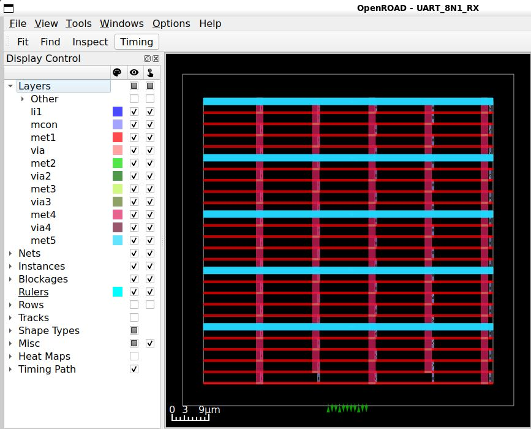
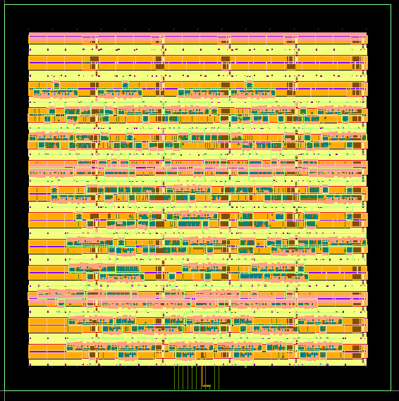
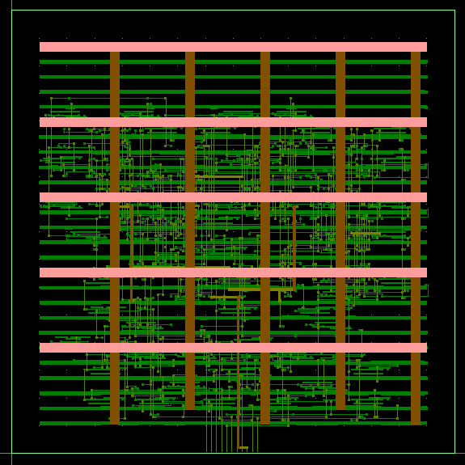

# UART Receiver ASIC — Part 2: Physical Design

## Overview

This is Part 2 of the UART_8N1_RX ASIC implementation project.

Part 1 covered RTL development, functional verification,
CDC analysis, synthesis, and equivalence checking.

Part 2 covers the physical implementation from the
synthesized design to GDSII, including DRC, LVS,
and post-route Static Timing Analysis.

## Technology and Tools

- Technology: SKY130HD (130 nm)
- Design: UART_8N1_RX
- Target Clock: 50 MHz (20 ns)
- Standard-Cell Library: sky130_fd_sc_hd
- Operating Environment: WSL Ubuntu / Docker
- Physical Design: OpenROAD
- DRC and LVS: KLayout
- Static Timing Analysis: OpenSTA / OpenROAD

## Physical Design Flow

1. Floorplanning
2. I/O Pin Placement
3. Tapcell Insertion
4. Power Distribution Network Generation
5. Global Placement
6. Detailed Placement
7. Clock Tree Synthesis (CTS)
8. Post-CTS Timing Repair
9. Global Routing
10. Detailed Routing
11. Filler Cell Placement
12. DEF and GDSII Generation
13. Design Rule Checking (DRC)
14. Layout Versus Schematic (LVS)
15. Post-Route Static Timing Analysis

## Verification Results

| Verification | Result |
|---|---|
| DRC | 0 reported violations |
| LVS | Netlists match |
| Clock Period | 20 ns |
| Post-route Setup WNS (TT) | +14.40 ns |
| Post-route Hold WNS (TT) | +0.35 ns |
| Synchronizer Setup Slack (TT) | +19.44 ns |
| Synchronizer Hold Slack (TT) | +0.35 ns |

Timing analysis was performed at the SKY130HD
TT, 25°C, 1.8 V corner using extracted routing parasitics.

## Important Implementation Notes

The original GDSII export produced incorrect geometry
for certain mirrored standard-cell placements.

The GDSII was regenerated with corrected
placement transformations and verified using DRC.

During LVS, power pins in the OpenROAD-exported
reference CDL were initially unconnected.

Global VDD and VSS connections were applied
before generating the corrected LVS reference CDL.

The resulting LVS comparison passed.

## Important Limitations

This project demonstrates an educational
RTL-to-GDSII ASIC implementation.

The reported DRC result applies to the selected
SKY130HD rule deck.

Timing verification was performed at the TT corner.
Multi-corner signoff, antenna verification, power
integrity analysis, and full reset signoff were
not completed.

This design is not claimed to be fabrication-ready.
## Physical Design Visualization

### Earlier Physical Design Stage

*Earlier physical-design view of the UART Receiver ASIC.*

### Final Routed Physical Layout

*Final routed GDSII layout of UART_8N1_RX implemented using SKY130HD and OpenROAD, visualized in KLayout.*

### Detailed Routing and Power Distribution

*Detailed physical-layout view highlighting the power-distribution structures and routed interconnect layers.*

The final corrected GDSII was checked using the selected SKY130HD DRC and LVS rule decks, resulting in zero reported DRC violations and a successful LVS comparison.

## Project Deliverables

- Physical-design Tcl scripts
- Routed and filled OpenDB snapshots
- Final DEF and corrected GDSII
- Final DRC and LVS reports
- Post-route timing constraints and reports
- Extracted SPEF parasitics

## Project Structure

- `pd/` — Physical implementation scripts and databases
- `gds/` — DEF and GDSII outputs
- `lvs/` — LVS netlist and verification outputs
- `reports/` — DRC reports
- `sta/` — Timing constraints, parasitics and STA results

The implementation dependson the SKY130HD platform
files and the OpenROAD-flow-scripts environment.
